# Glasshouse

English | [简体中文](./README.zh-CN.md)

Run AI agents inside a hardware-virtualized Ubuntu 26.04 LTS virtual machine, so they cannot reach your host's files, credentials or internal network. QEMU/KVM on Linux, Virtualization.framework on macOS. The design document is `设计文档与技术方案.md` (Chinese; a local file, listed in `.gitignore`, not part of the repository).

Full usage manual: [`USAGE.md`](./USAGE.md) (English) · [`USAGE.zh-CN.md`](./USAGE.zh-CN.md) (中文): starting, changing the configuration, adding CPU and memory, persistence, troubleshooting.

## Glasshouse AI SandBox for Vibe-coding

Vibe coding means handing the keyboard to an AI agent and letting it run commands, install packages and edit files for hours. That is productive, and it is also exactly when you least want the agent standing on your real machine. Glasshouse gives that workflow a disposable room with glass walls: the agent works freely inside, and you can see everything it does.

- **Let it run without babysitting.** Claude Code is preinstalled (newest release at build time) in an Ubuntu VM. A bad `rm -rf`, a hostile `postinstall` script or a prompt-injected tool call can only damage the VM, not your home directory, SSH keys or browser profile.
- **Your code goes in, reviewed changes come out.** `glasshouse run --shell ./proj` copies the project into `/workspace` (secrets such as `.env*` and `*.pem` are skipped). When you are happy, `glasshouse pull` shows a diff and writes only what you approve.
- **Sign in with your own subscription.** Run `claude` in the VM and log in with your Claude account; no API key has to be copied in. The default network policy allows only the login and API domains.
- **Watch what it does.** CC-Monitor hooks are baked into the image through Claude Code's system-wide managed settings, which the `agent` user cannot edit, and the host keeps a hash-chained audit log.
- **Pick the weight you need.** `--shell` is a light terminal-only VM that boots fast; `--gui` is a full GNOME desktop for agents that drive a browser or an app.
- **Clean slate every time.** A session lives in its own disk overlay, separate from the read-only base image. When the session stops (`glasshouse stop`, a timeout, or a shutdown inside the VM) the overlay is deleted, so the next `glasshouse run` starts clean; `glasshouse rm` then removes the leftover log and record. Nothing is restored on restart, so run `glasshouse pull` first. With `--keep` the disk stays after stop and `glasshouse start <session>` boots it again.

Typical loop: `glasshouse run --shell ./proj` → run `claude` and describe what you want → `glasshouse pull` to review and bring the result home.

## Contents

- [Glasshouse AI SandBox for Vibe-coding](#glasshouse-ai-sandbox-for-vibe-coding)
- [Features](#features)
- [Status (read first)](#status-read-first)
- [How isolation works](#how-isolation-works)
- [Installation](#installation)
- [Usage](#usage)
- [Entering the VM and detailed usage](#entering-the-vm-and-detailed-usage)
- [Network modes and Claude login](#network-modes-and-claude-login)
- [Policy configuration](#policy-configuration)
- [Command reference](#command-reference)
- [CC-Monitor integration](#cc-monitor-integration)
- [Project layout](#project-layout)
- [Differences from the design document](#differences-from-the-design-document)
- [First real-machine checklist](#first-real-machine-checklist)
- [Troubleshooting](#troubleshooting)

## Features

- **VM-level isolation**: the agent runs in its own Ubuntu 26.04 VM. The boundary is the hypervisor, not a container or file permissions.
- **No shared host directories**: no 9p, virtiofs or shared folders. The host packs your project into `/workspace`, and changes come back only after review.
- **Controlled networking**: the guest has no real NIC. Outbound HTTP(S) goes through a host-side proxy with a domain allowlist; private, loopback, link-local and cloud-metadata addresses are blocked, with DNS-rebinding protection.
- **Two ways to use Claude**: either an API key that stays on the host (the guest holds only a session token that the LLM gateway swaps for the real key), or a **subscription account logged in inside the guest** (no API key needed).
- **Tamper-evident audit log**: `audit.jsonl` is hash-chained and verified with `glasshouse logs --verify`. If the log cannot be written, the operation is refused (fail closed).
- **Policies can only tighten**: a project-level `.glasshouse.yaml` can make the policy stricter, never looser.
- **Resource limits**: vCPU, memory, disk, session timeout and egress byte caps, plus cgroups on Linux.
- **Two launch modes**: `--gui` starts a GNOME desktop VM and opens the desktop window; `--shell` starts a lightweight VM without a desktop and drops you into an agent shell in `/workspace`.
- **Claude Code preinstalled, newest release**: the image is built with the latest Claude Code (installed system-wide so the agent user cannot alter it). Rebuild the image to pick up a newer one.
- **Optional in-guest auditing**: integrates CC-Monitor to watch Claude Code inside the guest.

## Status (read first)

| Part | Status |
| --- | --- |
| Policy parsing and tighten-only merge, audit hash chain, network gate (allowlist, DNS-rebinding protection, private/metadata address blocking, traffic cap), HTTP proxy, LLM gateway, safe file import/export | Implemented, unit-tested; `go test -race ./...` passes |
| Session supervisor (audit socket, gateway/proxy listeners, cleanup, refuses to start on a corrupted audit log) | Implemented, tested end to end with a fake hypervisor |
| QEMU backend, cloud-init, CLI | Implemented. **Booted for real on Linux/KVM (amd64)** with both `headless` and `desktop` (GNOME) images: SSH, file import, offline mode, `pull` review, audit chain and CC-Monitor were checked. Not yet checked: `glasshouse gui`, an LLM round trip, the tamper test on `audit.jsonl`, and anything on arm64 |
| `image/build.sh` | Runs end to end on Ubuntu (both profiles); see the notes under "Build an image" |
| macOS backend (`vz-helper/`, Swift) | **Never compiled** (no Mac/Swift toolchain); a reviewed starting point only |
| CC-Monitor integration | Install and start steps checked against the upstream repo; **not yet verified on a real machine** |

On a real machine, go in this order: `glasshouse doctor` → build an image → `glasshouse run`. When something deviates, look at `glasshouse logs --console` first.

## How isolation works

- **Files**: no host directory is mounted. `glasshouse run ./proj` makes the host pack the project (skipping `.env*`, `*.pem`, `id_*`, `.git/config`, and dropping symlinks that point outside the project) into `/workspace`. `glasshouse pull` fetches `/workspace` back and the host parses the tar itself: it rejects absolute paths, `..`, hard links and device files, strips setuid bits, never writes through symlinks, and shows a diff before writing (`files.export: review`).
- **Network**: the guest has no real NIC. On Linux, QEMU user-mode networking with `restrict=on` leaves exactly three forwards: SSH in, proxy out, model gateway out. On macOS the VM has no NIC at all; everything goes over vsock. Outbound HTTP(S) goes only through the host proxy and is allowlisted by domain. Any resolved IP that is private, loopback, link-local (including cloud metadata) or the host itself is refused, and the connection is pinned to the checked IP. The proxy authenticates with a random per-session token.
- **Credentials**: the real model API key stays on the host (sources: `env:`, `file:`, `keychain:`, `secret-service:`). `ANTHROPIC_API_KEY` in the guest is just a session token; the gateway validates it, swaps in the real key, and forwards only `/v1/` paths.
- **SSH and root**: each session generates a throwaway ed25519 key kept only in the host session directory (0600) and deleted when the session ends. sshd accepts public keys only. `glasshouse ssh` opens a root shell by default; root inside the guest is not a security boundary, the VM is.
- **Audit**: `audit.jsonl` lives on the host and every record carries the previous record's hash; `glasshouse logs --verify` checks it. If the log cannot be written, network connections and file exports are refused (fail closed).
- **Resources**: vCPU/memory/disk caps; on Linux also cgroups (`systemd-run --user --scope`); session timeout; egress byte cap.

## Installation

### Requirements

| Item | Linux (QEMU/KVM) | macOS (Virtualization.framework) |
| --- | --- | --- |
| Go | see `go.mod` | same |
| Virtualization | `qemu-system-*`, read/write access to `/dev/kvm` (without KVM you need `--allow-tcg`, which is very slow) | Apple Silicon, Swift toolchain |
| Other tools | `ssh`, `ssh-keygen`, an ISO tool for the cloud-init seed (`genisoimage`, `xorriso`, …) | `codesign` |
| Viewing the desktop | `virt-viewer` (`remote-viewer`) | built-in window |
| Building images | `libguestfs-tools`, `isc-dhcp-client`, `qemu-utils`, `gpgv`, `git`, `curl`, `ubuntu-cloudimage-keyring` | build a raw image on arm64 Linux and copy it over |

On Debian/Ubuntu, install everything at once:

```bash
sudo apt install qemu-system-x86 qemu-utils genisoimage openssh-client virt-viewer \
                 libguestfs-tools isc-dhcp-client gpgv git curl ubuntu-cloudimage-keyring
sudo usermod -aG kvm "$USER"    # takes effect after you log in again
```

### 1. Build and test

```bash
make test        # go vet + go test -race
make build       # produces bin/glasshouse
./bin/glasshouse doctor
```

`doctor` checks ssh, the ISO tool, the policy file, the hypervisor and the images. The image check fails on a first run; that is expected.

### 2. Build an image

`image/build.sh` starts from Canonical's official cloud image (GPG-verified and SHA256-checked), installs developer tools and a pinned CC-Monitor commit, and writes the image plus its `.sha256`:

```bash
# CC_MONITOR_REF must be a reviewed 40-hex commit; the script never tracks a branch
CC_MONITOR_REF=<40-hex-commit> ./image/build.sh --profile headless   # for --shell
CC_MONITOR_REF=<40-hex-commit> ./image/build.sh --profile desktop    # for --gui, with GNOME desktop
# Claude Code is installed at its newest release by default; to override: CLAUDE_CODE_VERSION=stable (or an exact x.y.z)
CLAUDE_CODE_VERSION=stable CC_MONITOR_REF=<...> ./image/build.sh --profile headless
```

Options: `--arch amd64|arm64` (must match the host), `--profile headless|desktop`, `--format qcow2|raw`. Images are written to `$GLASSHOUSE_HOME/images/`.

Notes:

- **If your host uses a proxy**: libguestfs forwards proxy environment variables into the build guest, where `127.0.0.1` is the guest itself, so every apt call fails. The script now clears those variables around `virt-customize`; the base image download still uses your proxy.
- Claude Code is installed from npm (`@anthropic-ai/claude-code`, Node 22 or newer is required and the image's nodejs satisfies it). The build installs the newest release (`latest`) and fails if `claude --version` does not run; the installed version is recorded in `/etc/glasshouse-claude-code-version` inside the image.
- libguestfs needs a DHCP client (`isc-dhcp-client`) to give the build guest a network; without it every apt call fails with "Temporary failure resolving". The script checks for `dhclient` up front.
- The root partition is grown **in place** before installing packages. Do not use `virt-resize` here: it renumbers and moves partitions, which breaks GRUB's BIOS boot record (the VM hangs at "Booting from Hard Disk...").
- CC-Monitor's npm dependencies live in the `webui/` subdirectory of its repo. The script handles that (`npm ci --omit=dev`) and fails the build if it breaks. Override with `CC_MONITOR_SETUP_CMD`.
- The build needs internet access. The base image is about 800 MB and is cached in `$GLASSHOUSE_HOME/cache/`.
- **Mirrors for mainland China.** `--mirror auto|official|tuna|ustc` (or `GLASSHOUSE_MIRROR`) picks where the cloud image and the build guest's APT packages come from:

  ```bash
  ./image/build.sh --profile headless                  # auto: probes the official servers, Tsinghua (tuna) and USTC
  ./image/build.sh --profile headless --mirror tuna    # force Tsinghua
  ./image/build.sh --profile headless --mirror ustc    # force USTC
  ```

  `auto` stays on Canonical's servers unless they are unreachable or a mirror is at least twice as fast, prints what it measured, and falls back to the next source if a download fails. The image is **always** verified against Canonical's GPG-signed `SHA256SUMS`, and apt verifies its own signatures, so a mirror does not have to be trusted. The guest's APT source is switched to the mirror only for the build and put back to the official one at the end, so `network.allow` (which lists `archive.ubuntu.com`) keeps working; `--keep-mirror` leaves the mirror in the image, in which case add its host to `network.allow` (or use `network.mode: host`). Notes: USTC refused the image download from some networks (HTTP 403), which is why `auto` falls back; the mirrors serve `resolute/current`, the same image as the official `releases/26.04/release` (identical checksum when this was checked).
  Other optional environment variables: `APT_MIRROR=https://host/ubuntu` (any APT mirror), `NPM_REGISTRY=https://registry.npmmirror.com` (npm registry for CC-Monitor's dependencies and Claude Code), `CC_MONITOR_REPO=<https git URL>` (a GitHub mirror; the pinned commit hash is still verified). In China GitHub and npm are often the slow steps, and the script prints a tip when a mirror was selected.

#### Build flow

```mermaid
flowchart TD
  A["image/build.sh<br/>--profile / --arch / --format / --mirror"] --> B["Check arguments and tools<br/>CC_MONITOR_REF is a 40-hex commit<br/>Linux host, same CPU architecture<br/>qemu-img, gpgv, git, curl, virt-customize ...<br/>Canonical keyring present"]
  B --> C{"--mirror"}
  C -- auto --> D["Probe official / tuna / ustc in parallel<br/>time the first 512 KiB of the image"]
  C -- "official / tuna / ustc" --> E["Chosen source, official as fallback"]
  D --> F["Candidate order: picked source first, then the rest"]
  E --> F
  F --> G["For one candidate:<br/>fetch SHA256SUMS and SHA256SUMS.gpg"]
  G --> H{"Canonical GPG signature valid?"}
  H -- no --> N{"Another candidate left?"}
  H -- yes --> I{"Cached image matches the signed hash?"}
  I -- yes --> K
  I -- no --> J["Download the image, check the hash"]
  J -- failed --> N
  J -- ok --> K["Verified cloud image<br/>APT source = same mirror, or APT_MIRROR"]
  N -- yes --> G
  N -- no --> X["Abort: no verified image"]
  K --> L["Clone CC-Monitor (CC_MONITOR_REPO)<br/>check out the pinned commit, verify the hash, drop .git"]
  L --> M["Copy the image to a work file<br/>write the systemd unit and cloud-init config"]
  M --> O["Grow the root partition in place<br/>headless 8 GB / desktop 20 GB<br/>keeps the BIOS boot record intact"]
  O --> P["Resolve Claude Code version (default latest)<br/>check dhclient for libguestfs networking"]
  P --> Q1

  subgraph VC ["virt-customize: runs inside the guest, in this order"]
    Q1["1. If a mirror is used: point APT at it"] --> Q2["2. apt update/upgrade, install base packages"]
    Q2 --> Q3{"desktop profile?"}
    Q3 -- yes --> Q4["3. Install GNOME<br/>ubuntu-desktop-minimal, gdm3"]
    Q3 -- no --> Q5
    Q4 --> Q5["4. Copy the cloud-init config"]
    Q5 --> Q6["5. Install Claude Code first<br/>Node >= 22 check, npm install -g,<br/>claude --version into the version file"]
    Q6 --> Q7["6. Install CC-Monitor<br/>copy files, npm ci, ownership and permissions"]
    Q7 --> Q8["7. While installing CC-Monitor, hook Claude Code<br/>install.py --target /etc/claude-code/managed-settings.json<br/>requires the Claude Code version file to exist"]
    Q8 --> Q9["8. Mask auto-updates, enable ssh, cloud-init clean"]
    Q9 --> Q10["9. Restore the official APT source<br/>unless --keep-mirror"]
    Q10 --> Q11{"desktop profile?"}
    Q11 -- yes --> Q12["graphical.target, remove gnome-initial-setup, enable gdm3"]
    Q11 -- no --> Q13["multi-user.target"]
  end

  Q12 --> R
  Q13 --> R["virt-sysprep cleanup<br/>qemu-img convert (qcow2 compressed, or raw)<br/>write the .sha256 file"]
  R --> S["images/ubuntu-26.04-arch-profile.qcow2<br/>and its .sha256"]
```



At session start the hooks are already in the image; a session with `monitor.cc_monitor: false` removes `/etc/claude-code/managed-settings.json`, and an image built without the hooks gets them installed as a fallback (see `internal/cloudinit`).

### 3. macOS

```bash
# First, on arm64 Linux: ./image/build.sh --format raw ...
# Copy the raw image and its .sha256 to ~/.local/share/glasshouse/images/
make vz-helper   # builds and ad-hoc signs the Virtualization.framework helper
```

### 4. Configure the model key

```bash
mkdir -p ~/.config/glasshouse && cat > ~/.config/glasshouse/policy.yaml <<'YAML'
version: 1
credentials:
  llm_gateway:
    key_ref: keychain:glasshouse-anthropic     # or env:ANTHROPIC_API_KEY / secret-service:glasshouse / file:/path
YAML
./bin/glasshouse policy check
```

## Usage

### Launch modes

| Mode | Command | What you get |
| --- | --- | --- |
| GUI desktop | `glasshouse run --gui ./proj` | GNOME desktop VM (`desktop` image); the desktop window opens when the session is ready (needs `remote-viewer`, otherwise the VNC socket path is printed) |
| Lightweight SSH shell | `glasshouse run --shell ./proj` | VM without a desktop (`headless` image, smaller and faster to boot); you land in an `agent` shell in `/workspace` |
| Policy default | `glasshouse run ./proj` | whatever `vm.profile` in the policy says (`desktop` by default) |

`--headless` is an alias of `--shell`, and `--mode gui|shell` is the long form. Mode flags never loosen the policy: `--gui` is refused if the user policy or the project's `.glasshouse.yaml` already forces `headless`. Shell mode keeps the session running after you leave the shell; use `glasshouse ssh` to get back in and `glasshouse stop` to shut it down. Add `--offline` to either mode to cut all outbound network.

### Commands

```bash
./bin/glasshouse run --shell ./myproject       # lightweight shell mode
./bin/glasshouse run --gui ./myproject         # desktop mode
./bin/glasshouse run ./myproject -- claude     # copy the project into /workspace, run claude as the agent user
./bin/glasshouse ssh                           # root shell in the guest
./bin/glasshouse gui                           # open the desktop (desktop profile)
./bin/glasshouse monitor                       # open the CC-Monitor UI
./bin/glasshouse pull                          # review the diff and bring changes back
./bin/glasshouse logs --verify                 # verify the audit hash chain
./bin/glasshouse stop                          # stop the session
```

Typical flow: `run` → let the agent work in the guest → `pull` to review and fetch changes → `logs --verify` → `stop`.

To keep the agent fully offline (model gateway only): `glasshouse run --headless --offline ./proj -- claude`.

Session data lives in `$GLASSHOUSE_HOME` (default `~/.local/share/glasshouse`). Unix socket paths have a length limit; if the path is too long, set a shorter `GLASSHOUSE_HOME`.

## Entering the VM and detailed usage

### Entering the VM

| I want to… | Command |
| --- | --- |
| Start a VM and land in a shell | `glasshouse run --shell ./myproject` |
| Start a VM with a desktop | `glasshouse run --gui ./myproject` |
| Get back into a running VM (root shell) | `glasshouse ssh` |
| Get back in as the unprivileged user | `glasshouse ssh --user agent` |
| Run one command in the VM | `glasshouse ssh -- bash -c 'cd /workspace && ls -la'` |
| Run Claude Code straight away | `glasshouse run --shell ./myproject -- claude` |
| Reopen the desktop window | `glasshouse gui` |

**Picking the session.** Every command that takes `[session]` accepts a session ID (see `glasshouse ls`). If you leave it out it works only when **exactly one** session is running; with several running it refuses and lists their IDs, so name one: `glasshouse ssh s-1a2b3c`.

**Session states** (`glasshouse ls`): `starting` → `ready` (usable) → `stopping` → `stopped`; `failed` means boot or setup failed (see `glasshouse logs --console`); `dead` means the supervisor process died (clean up with `glasshouse rm <session>`).

### `glasshouse run`

`glasshouse run [flags] [dir] [-- command...]`

- `dir` (optional) is copied into `/workspace` in the guest, minus the files in `files.deny_patterns` and symlinks that point outside it. Without a `dir` the guest starts with an empty `/workspace`.
- `-- command...` runs that command as the `agent` user in `/workspace` after the VM is ready (for example `-- claude`, `-- bash -l`). With `--shell` and no command you get an interactive `agent` shell; with `--gui` the desktop window opens.
- The first boot of a session takes a minute or two. `glasshouse run` waits up to 6 minutes for the VM.
- Flags: `--shell`/`--headless`, `--gui`, `--mode gui|shell`, `--offline`, `--policy FILE`, `--keep`, `--allow-tcg`. See the table under "Launch modes".
- **Leaving the shell does not stop the VM.** The session keeps running until `glasshouse stop`.

### `glasshouse ssh`

`glasshouse ssh [--user root|agent] [session] [-- command...]`

- `--user root` (default) opens a root shell in the guest. It is refused if the policy sets `ssh.root: false`; use `--user agent` then. Root inside the guest is **not** a security boundary, the VM is.
- `--user agent` is the unprivileged user that owns `/workspace`. It starts in `/home/agent`; `cd /workspace` to get to the project.
- Everything after `--` is passed as separate arguments, so wrap a compound command in `bash -c '...'`.
- Each login is recorded in the audit log (`ssh.login`). Access uses a throwaway key kept in the session directory, so you cannot ssh into the VM from another tool.

### `glasshouse gui`

`glasshouse gui [session]` opens the desktop of a `--gui` (desktop profile) session. It needs `remote-viewer` and `socat` (`apt install virt-viewer socat`). The VM's display is a VNC unix socket that virt-viewer 11 cannot open directly, so `glasshouse` starts a one-shot `socat` bridge on 127.0.0.1 (a random port, one connection, closed after a minute if nobody connects) and points `remote-viewer` at it. The display has no password, so while that port is open any local user could connect. A `--shell` session has no desktop and `gui` refuses to open it. The desktop logs in automatically as `agent`.

### `glasshouse monitor`

`glasshouse monitor [session] [--no-open]` opens the CC-Monitor web UI of the guest through a token-protected loopback proxy on the host (`--no-open` only prints the address). It is available when `monitor.cc_monitor` is on, and it is a convenience view, not a root of trust: use `glasshouse logs` for the authoritative record.

### `glasshouse pull`: bring changes back

`glasshouse pull [--yes] [--delete] [session] [dir]`

- Fetches `/workspace` from the guest and shows what would change (`modified`, `added`, and so on) before writing anything. Answer `y` to apply, anything else to cancel.
- `dir` defaults to the project the session was started with. For a session started without a project you must give an existing directory.
- The host parses the archive itself and **skips unsafe entries** (absolute paths, `..`, hard links, device files, symlinks that point outside, setuid bits are dropped); the summary says how many were skipped.
- `--yes` applies without asking (only when `files.export` is `review`). `--delete` also deletes project files that no longer exist in the guest. `files.export: deny` refuses all exports; `auto` applies them without review.

### `glasshouse logs`

`glasshouse logs [--follow|--verify|--console] [session]`

- default: the audit log (session start/stop, `ssh.login`, `exec`, `files.import`/`files.export`, `net.deny`, …)
- `--follow` keeps printing new events; `--verify` checks the hash chain and exits non-zero if it was tampered with; `--console` prints the guest's serial console, the first thing to read when a VM does not come up.

### `glasshouse stop` and `glasshouse rm`

- `glasshouse stop [session]` shuts the VM down and **deletes its disk: everything that was only inside the guest is gone.** `pull` first. The audit log and the session record stay.
- `glasshouse run --keep` keeps the disk after stop; `glasshouse start <session>` boots it again.
- `glasshouse rm <session>` removes a stopped, failed or dead session's directory, including the audit log.

### Typical workflows

```bash
# Lightweight shell, work, bring the result back
glasshouse run --shell ./myproject          # you are now in an agent shell in /workspace
#   ...work inside the guest, exit with `exit`...
glasshouse pull                             # review the diff and apply
glasshouse logs --verify                    # check the audit chain
glasshouse stop

# Desktop session
glasshouse run --gui ./myproject            # desktop window opens
glasshouse ssh --user agent                 # a terminal next to it
glasshouse pull && glasshouse stop

# Several sessions at once
glasshouse ls
glasshouse ssh s-1a2b3c
glasshouse stop s-1a2b3c
```

### Usage troubleshooting

- **`no running session; start one with glasshouse run`**: nothing is running; `glasshouse ls` shows what exists.
- **`several sessions are running (...); name one`**: add the session ID.
- **`session ... is not running (state: ...)`**: it stopped, failed or died; see `glasshouse logs --console <session>`, then `glasshouse rm <session>`.
- **`policy ssh.root is false for this session`**: use `--user agent`.
- **`remote-viewer not found`**: install `virt-viewer` and `socat`, then run `glasshouse gui <session>`. If `remote-viewer` fails with `vnc_display_open_host: assertion 'host != NULL' failed`, you ran it on the `vnc+unix://` address by hand; use `glasshouse gui` instead.
- **The desktop window is black ("Display output is not active.") or asks for a password**: the screen was blanked and then **locked** after 5 idle minutes. The guest users have no password, so it cannot be unlocked by typing one. Get in from the host: `glasshouse ssh <session> -- loginctl unlock-sessions`, then move the mouse. New sessions no longer lock, blank or suspend (cloud-init sets the GNOME defaults). A session created earlier keeps its old settings, so turn them off once inside it: `glasshouse ssh --user agent <session> -- bash -c 'export XDG_RUNTIME_DIR=/run/user/$(id -u) DBUS_SESSION_BUS_ADDRESS=unix:path=/run/user/$(id -u)/bus; gsettings set org.gnome.desktop.screensaver lock-enabled false; gsettings set org.gnome.desktop.session idle-delay 0; gsettings set org.gnome.settings-daemon.plugins.power sleep-inactive-ac-type nothing'`. Or give `agent` a password with `sudo passwd agent` (as root: `passwd agent`).
- **`this session was started without a GUI`**: start it with `--gui`.
- **`ssh` says the command is not found**: you passed a compound command as one argument; use `-- bash -c '...'`.

## Network modes and Claude login

`network.mode` in your policy picks how the guest reaches the network:

| Mode | What the guest can reach | Trade-off |
| --- | --- | --- |
| `allowlist` (default) | Only the listed `host:port` entries, through the host proxy (private/loopback/metadata addresses refused, egress capped) | Strongest; HTTP(S) only |
| `offline` | Nothing except the model gateway | Strongest; no subscription login possible |
| `host` | **The host's network directly** (QEMU user-mode NAT: the host's routing, DNS, proxy/TUN, VPN) | The allowlist, private-address blocking and egress cap **do not apply**. The guest can reach anything the host can, including the host LAN and `10.0.2.2` (the host's loopback services). A project's `.glasshouse.yaml` can never select it, and `glasshouse` prints a warning and records it in the audit log. Not supported on macOS yet |

```yaml
# ~/.config/glasshouse/policy.yaml
version: 1
network:
  mode: host
```

**Logging in to Claude Code with a subscription account** (inside the guest, no API key):

1. Do not set `credentials.llm_gateway.key_ref`. Without it, `glasshouse` does not inject `ANTHROPIC_BASE_URL` / `ANTHROPIC_API_KEY`, which would otherwise override the login.
2. Make the login domains reachable: `network.mode: host`, or keep `allowlist` (the defaults include `claude.ai`, `platform.claude.com` and `api.anthropic.com`).
3. `glasshouse run --shell ./proj`, then run `claude` in the guest shell and choose the subscription login. Open the printed URL in a browser on your own machine and paste the code back into the terminal.

The login token is stored in the guest (`~/.claude/.credentials.json`), so a compromised guest can use your subscription. In `allowlist` mode it can at most talk to the allowlisted domains; in `host` mode it can send it anywhere. Prefer `allowlist` unless you need the host network. With an API key (`key_ref` set) the real key stays on the host instead.

## Policy configuration

The policy file defaults to `~/.config/glasshouse/policy.yaml` (or `$GLASSHOUSE_POLICY`, or `--policy`). A `.glasshouse.yaml` in the project root can only tighten it. See [`docs/policy.example.yaml`](./docs/policy.example.yaml) for a full example. Main fields:

| Field | Values / meaning |
| --- | --- |
| `vm.profile` | `headless` / `desktop` |
| `vm.cpus` `vm.memory` `vm.disk` `vm.timeout` | resource and session-length limits; `timeout: 0` means unlimited |
| `ssh.root` | whether `glasshouse ssh` may open a root shell |
| `files.mode` | `copy` (pack and import) / `none` |
| `files.export` | `review` (show diff first) / `auto` / `deny` |
| `files.deny_patterns` `files.max_import` | patterns skipped on import, and the total size cap |
| `network.mode` | `allowlist` (default) / `offline` / `host` (the guest uses the host network directly, see below) |
| `network.allow` | allowed `host:port` entries |
| `network.max_egress` | outbound byte cap |
| `monitor.cc_monitor` | enable CC-Monitor inside the guest |
| `credentials.llm_gateway` | `provider` and `key_ref` (`env:`, `file:`, `keychain:`, `secret-service:`) |

`policy.yaml` uses a built-in YAML subset parser. Anything outside the subset is an error, not silently ignored.

## Command reference

Session arguments are session IDs such as `s-abc123`. When omitted, `ssh`, `gui`, `monitor`, `pull`, `logs` and `stop` pick the only running session and fail if several are running.

| Command | What it does |
| --- | --- |
| `glasshouse doctor` | check the host (hypervisor, tools, policy, images) |
| `glasshouse run [flags] [dir] [-- command...]` | create and start a session |
| `glasshouse start <session> [-- command...]` | boot a stopped session again (needs `run --keep`) |
| `glasshouse ssh [--user root\|agent] [session] [-- command...]` | open a shell in the VM (default user `root`) |
| `glasshouse gui [session]` | open the desktop window |
| `glasshouse monitor [session]` | open the CC-Monitor web UI |
| `glasshouse pull [--yes] [--delete] [session] [dir]` | bring guest changes back, with a diff first |
| `glasshouse ls` | list sessions |
| `glasshouse logs [--follow\|--verify\|--console] [session]` | audit log, hash-chain check, or guest console |
| `glasshouse stop [session]` | stop a session |
| `glasshouse rm <session>` | delete a stopped session's record |
| `glasshouse policy check [file]` | validate a policy file |

### `run`

| Flag | Meaning |
| --- | --- |
| `--shell` (alias `--headless`) | lightweight mode: `headless` image, no desktop, lands in an `agent` shell in `/workspace` |
| `--gui` | desktop mode: GNOME, opens the desktop window when ready (needs `remote-viewer`, otherwise the VNC socket path is printed) |
| `--mode gui\|shell` | same as the two flags above |
| `--offline` | no outbound network except the model gateway |
| `--keep` | keep the session disk after stop, so `glasshouse start` can boot it again |
| `--policy FILE` | user policy (default `~/.config/glasshouse/policy.yaml` or `$GLASSHOUSE_POLICY`) |
| `--allow-tcg` | allow very slow software emulation when `/dev/kvm` is missing |

Without a mode flag, `vm.profile` in the policy decides (`desktop` by default). A mode flag never loosens the policy: `--gui` is refused if the policy forces headless. The project directory is copied into `/workspace` (without `.env*`, `*.pem`, `id_*`, `.git/config` or symlinks pointing outside it). A command after `--` runs as `agent` in `/workspace`. In shell mode, leaving the shell does **not** stop the VM; `glasshouse stop` does.

```bash
glasshouse run --shell ./myproject            # lightweight shell; run claude inside
glasshouse run --gui ./myproject              # desktop
glasshouse run ./myproject -- claude          # run claude directly
glasshouse run --keep --shell ./myproject     # keep the disk after stop
glasshouse run --offline --shell ./myproject  # no network
```

### `start`

`glasshouse start <session> [-- command...]` boots a session that was created with `run --keep` and has stopped. What was installed or changed inside the VM is still there, and the project is not copied again. The session keeps the policy it was created with. It is refused when the base image has been rebuilt since, because the kept disk is layered on the old image. A fresh SSH key and token are installed on every start. A session whose supervisor vanished (host reboot, `kill -9`; shown as `dead` in `ls`) can be started too. Verified on a real machine: files in `/workspace` and the home directory survive stop → start and a killed supervisor.

### `start.sh`: the desktop VM that keeps its data

`./start.sh` in the repository root wraps the commands above for the GNOME desktop:

```bash
./start.sh [project-dir]   # first run: create a desktop session with --keep; later runs: boot it again
./start.sh stop            # shut the VM down; the disk is kept
./start.sh status          # show the saved session and its state
./start.sh reset           # delete the saved session and everything inside it (asks for the session id)
```

The session id is saved in `~/.local/share/glasshouse/desktop-session`. Installed software, files and the Claude login survive stop, restart and a reboot of the host. A rebuilt base image (`image/build.sh`) makes the saved disk unusable, so `glasshouse pull` your work before rebuilding; `start.sh` then refuses with an explanation and never deletes anything on its own.

### `ssh`, `pull`, and the rest

```bash
glasshouse ssh                            # root shell in the only running session
glasshouse ssh --user agent s-abc123      # as the agent user
glasshouse ssh --user agent -- ls /workspace

glasshouse pull                           # show a diff, write only after you confirm
glasshouse pull --yes                     # no prompt (only when files.export is review)
glasshouse pull --delete                  # also delete project files that no longer exist in the guest
glasshouse pull s-abc123 ./out            # a given session and target directory

glasshouse logs --verify                  # check the audit hash chain
glasshouse logs --console                 # guest serial console (look here first when boot fails)
glasshouse stop                           # stop; the disk is deleted unless the session was run with --keep
```

`glasshouse ls` states: `starting` → `ready` (usable) → `stopping` → `stopped`; `failed` means boot or setup failed; `dead` means the supervisor process died (clean up with `rm`).

## CC-Monitor integration

[CC-Monitor](https://www.cc-monitor.com) is an audit and guard tool for Claude Code (hooks that block or ask; a local web UI on 127.0.0.1:9999 with **no authentication**). How it is wired in:

- `image/build.sh` installs Claude Code first, then CC-Monitor at a pinned commit (`CC_MONITOR_REF=<40-hex commit>`, never a branch), and hooks Claude Code **while installing CC-Monitor**: `install.py --target /etc/claude-code/managed-settings.json` writes the hooks into Claude Code's system-wide managed settings. That file is root-owned (0644), so the `agent` user cannot edit it, and it works for any user, which matters because the `agent` user does not exist yet when the image is built. The script refuses to hook unless Claude Code is already installed.
- At session start cloud-init only starts the `glasshouse-cc-monitor` service; the hooks are already in the image. Set `monitor.cc_monitor: false` to turn the monitor off: such a session deletes `/etc/claude-code/managed-settings.json` again. A project's `.glasshouse.yaml` cannot turn it off. An image built before the hooks were baked in gets them installed as a guarded fallback, so a session never runs unmonitored without saying so.
- `glasshouse monitor` reaches the guest UI over an SSH unix-socket forward, then exposes it through a token-protected loopback proxy on the host (it checks the Host header against DNS rebinding and does not forward cookies to the guest app). The UI is never exposed on a TCP port directly.
- It is a **convenience layer, not a root of trust**: it runs inside the untrusted guest, its logs can be edited by guest root, and its rules are regexes that can be bypassed. The host's `audit.jsonl` is the record of truth.
- It reads `~/.claude/.credentials.json` to check quota. In API-key mode that file does not exist in the guest (and the gateway only passes `/v1/`), so the quota page does not work. With a subscription login inside the guest the file exists and the page can work.

## Project layout

```
cmd/glasshouse/      CLI entry point and session supervisor
internal/policy/     policy parsing and tighten-only merge
internal/miniyaml/   YAML subset parser
internal/audit/      hash-chained audit log
internal/netd/       network gate, HTTP proxy, LLM gateway
internal/secrets/    key sources (env/file/keychain/secret-service)
internal/fsbridge/   safe file import/export
internal/cloudinit/  cloud-init data generation
internal/session/    session directory and lifecycle
internal/backend/    hypervisor abstraction; qemu/ and vz/ backends
image/build.sh       image build script
vz-helper/           Swift helper for macOS
docs/                policy example; PROGRESS.md (development progress) and CHANGELOG.md (code change log) are local notes listed in .gitignore
```

## Differences from the design document

To avoid depending on root and third-party libraries, the implementation changed these things; the matching sections of the design document can be updated accordingly:

1. gvisor-tap-vsock is not used; everything is standard library. On Linux, QEMU's `restrict=on` user-mode networking plus `guestfwd` replaces a custom network stack. As a result, non-HTTP(S) outbound traffic from the guest (for example raw SSH to GitHub) is **not supported** for now; use HTTPS for git.
2. On Linux, SSH uses `hostfwd=127.0.0.1:<random port>`, not vsock (vsock needs `/dev/vhost-vsock` permissions). macOS uses vsock plus a host unix socket.
3. There is no separate `glasshoused` daemon: each session has its own supervisor process (`glasshouse _supervise`), and the CLI talks to it through the session directory and `audit.sock`.
4. There is no `guestd`: command execution and file transfer use ssh directly.
5. `policy.yaml` uses the built-in YAML subset parser (nested maps, scalar lists, inline lists, comments).
6. `monthly_budget` is parsed but **not enforced**; the gateway only has a per-session request-count hook.
7. An executable-bit change on export is flagged in the diff for you to confirm, rather than rejected outright.

## First real-machine checklist

1. `glasshouse doctor` is all green; `glasshouse policy check` shows no unexpected warnings.
2. `glasshouse run --headless --offline`, then `glasshouse ssh` opens a root shell; `curl https://example.com` must fail inside the guest.
3. Without `--offline`: `apt update` works through the proxy; `curl http://192.168.x.x` and `curl http://169.254.169.254` must be refused; `glasshouse logs` shows `net.deny`.
4. `env | grep ANTHROPIC` in the guest shows only the session token, not the real key.
5. Put a symlink to `/etc` and a file with a `../` path in the guest's `/workspace`; `glasshouse pull` must reject or skip them.
6. `glasshouse logs --verify` passes; after hand-editing one line of `audit.jsonl` it must fail.
7. `desktop`: `glasshouse gui` shows the desktop; `glasshouse monitor` opens the UI, and `ss -ltn` on the host shows exactly one extra 127.0.0.1 port.
8. After `kill -9` on the supervisor, `glasshouse ls` shows `dead` and `glasshouse rm` cleans up.

## Troubleshooting

- **`doctor` says an image is missing its `.sha256`**: images must be built with `image/build.sh`, which also writes the checksum file.
- **The model gateway refuses requests**: you are in API-key mode without a key. Set `credentials.llm_gateway.key_ref`, or leave it unset and log in with a subscription inside the guest (see "Network modes and Claude login").
- **Image build is very slow or times out downloading**: use a mirror, `./image/build.sh --mirror tuna` (see "Build an image"), and set `NPM_REGISTRY` / `CC_MONITOR_REPO` if the npm or GitHub steps are the slow ones.
- **apt fails with `Unable to connect to 127.0.0.1:...` during an image build**: the host proxy leaked into the guest; see the notes under "Build an image".
- **Allowlisted domains are denied with `private-or-host-address`**: your DNS returns fake IPs (e.g. `198.18.0.x` from a Clash/TUN fake-ip setup), which the network gate treats as non-public and refuses. Either use a resolver that returns real addresses on the host, or set `network.mode: host` so the guest uses the host network (and its proxy/TUN) directly.
- **No `/dev/kvm`**: add your user to the `kvm` group; use `--allow-tcg` only if KVM truly is unavailable, and expect it to be very slow.
- **Unix socket path too long**: set a shorter `GLASSHOUSE_HOME`.
- **`git clone git@github.com:...` fails in the guest**: raw SSH egress is unsupported; use HTTPS.
