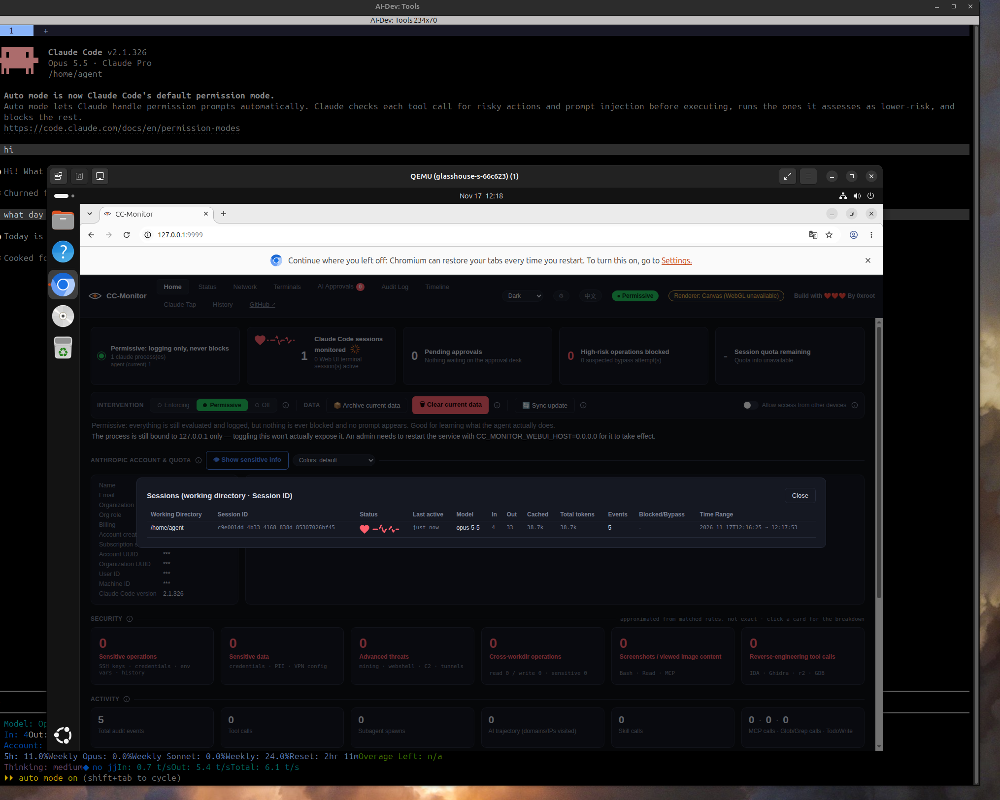
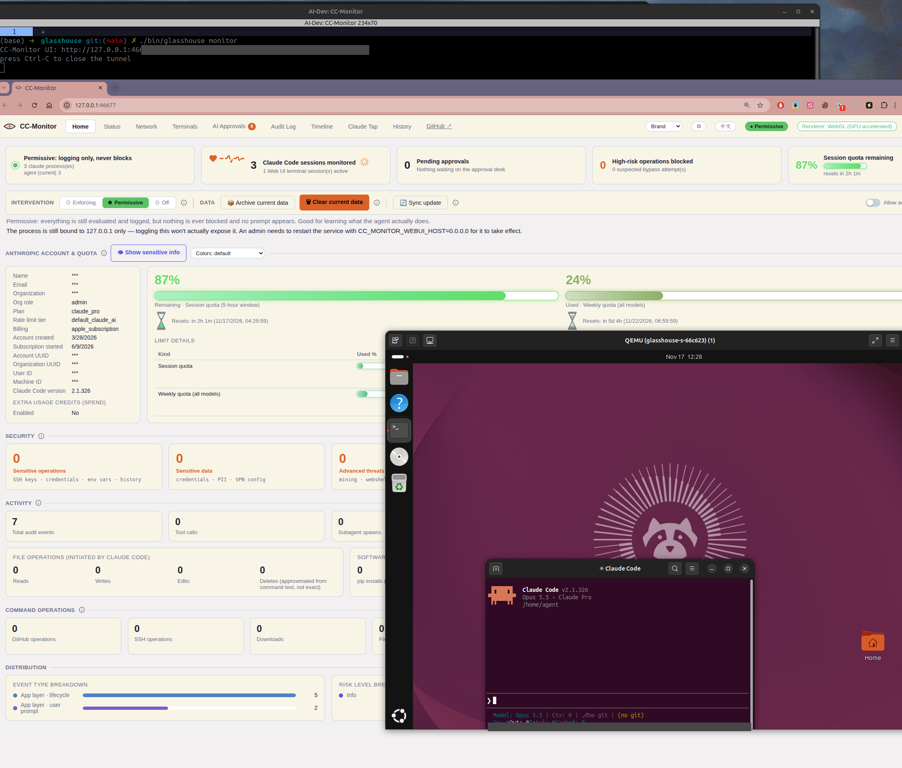

# Glasshouse

[English](./README.md) | 简体中文

在硬件虚拟化的 Ubuntu 26.04 LTS 虚拟机里运行 AI Agent，让它碰不到宿主机的文件、凭证和内网。Linux 用 QEMU/KVM，macOS 用 Virtualization.framework。

完整使用手册：[`USAGE.zh-CN.md`](./USAGE.zh-CN.md)（中文）· [`USAGE.md`](./USAGE.md)（English），涵盖启动、修改配置、增加 CPU 和内存、数据保留、排错。版本更新记录：[`CHANGELOG.zh-CN.md`](./CHANGELOG.zh-CN.md)（中文）· [`CHANGELOG.md`](./CHANGELOG.md)（English）。

## Glasshouse AI SandBox for Vibe-coding

Vibe coding 就是把键盘交给 AI Agent，让它连续几个小时自己跑命令、装依赖、改文件。效率很高，但这恰恰是你最不想让它直接待在真实机器上的时候。Glasshouse 给这种工作方式准备一间用完即弃、四面透明的玻璃房：Agent 在里面随便折腾，你能看到它做的每一件事。

- **放手让它跑，不用盯着。** 虚拟机里预装了 Claude Code（构建时的最新版）。一条写错的 `rm -rf`、恶意的 `postinstall` 脚本、被提示词注入的工具调用，最多只能破坏虚拟机，碰不到你的主目录、SSH 密钥和浏览器资料。
- **代码送进去，审过的改动再带回来。** `glasshouse run --shell ./proj` 把项目复制到 `/workspace`（`.env*`、`*.pem` 等密钥文件不会带入）。满意之后用 `glasshouse pull`，先给你看 diff，只写入你确认的内容。
- **用自己的订阅账号登录。** 在虚拟机里运行 `claude`，用你的 Claude 账号登录，不用把 API Key 拷进去。默认网络策略只放行登录和 API 相关域名。
- **看得见它在做什么。** CC-Monitor 的 hook 通过 Claude Code 的系统级托管设置写进镜像，`agent` 用户改不了；宿主机上还有哈希链审计日志。
- **按需选择轻重。** `--shell` 是只有终端的轻量虚拟机，启动快；`--gui` 是完整的 GNOME 桌面，适合要操作浏览器或应用的 Agent。
- **每次都是干净状态。** 会话有自己的磁盘覆盖层，和只读的基础镜像分离。会话停止时（`glasshouse stop`、超时，或在虚拟机里关机）覆盖层会被删除，下次 `glasshouse run` 从干净状态开始；`glasshouse rm` 再清掉剩下的日志和记录。重启后不会恢复里面的内容，所以停止前务必先 `glasshouse pull`。加 `--keep` 时磁盘在停止后保留，可用 `glasshouse start <会话>` 再次启动。

典型流程：`glasshouse run --shell ./proj` → 运行 `claude` 并描述需求 → `glasshouse pull` 审阅并把结果带回本机。

## 演示


*`glasshouse ssh` 进入 Ubuntu 26.04.1 虚拟机的 root shell（左）；同一台虚拟机的 GNOME 桌面运行在 QEMU 窗口里（右）。*



*Claude Code 2.1.326 在虚拟机里用 Claude Pro 订阅账号登录运行（`agent` 用户，目录 `/home/agent`）。虚拟机里的浏览器打开 `127.0.0.1:9999` 的 CC-Monitor 界面：这个 Claude Code 会话已被监控，事件进入了审计日志。模式是 Permissive（只记录，不拦截）。*



*`glasshouse monitor` 通过 SSH 隧道和带令牌的本地代理，在宿主机的浏览器里打开虚拟机里的 CC-Monitor 界面（图中打印出的 URL 里的令牌已隐藏）。界面显示 Claude Pro 套餐和额度，以及虚拟机桌面（右）里运行的 Claude Code 会话的审计事件。账号名称、邮箱和各种 ID 由 CC-Monitor 的"敏感信息"开关遮盖。*

## 目录

- [Glasshouse AI SandBox for Vibe-coding](#glasshouse-ai-sandbox-for-vibe-coding)
- [演示](#演示)
- [核心功能](#核心功能)
- [状态（请先读）](#状态请先读)
- [它怎么隔离](#它怎么隔离)
- [安装指南](#安装指南)
- [使用方法](#使用方法)
- [进入虚拟机与详细用法](#进入虚拟机与详细用法)
- [网络模式与 Claude 登录](#网络模式与-claude-登录)
- [策略配置](#策略配置)
- [命令参考](#命令参考)
- [CC-Monitor 集成](#cc-monitor-集成)
- [项目结构](#项目结构)
- [首次真机验证清单](#首次真机验证清单)
- [常见问题](#常见问题)

## 核心功能

- **虚拟机级隔离**：Agent 跑在独立的 Ubuntu 26.04 虚拟机里，隔离边界是 hypervisor，不是容器或权限位。
- **不共享宿主机目录**：没有 9p / virtiofs / 共享文件夹。项目由宿主机打包送入 `/workspace`，改动经审阅后才取回。
- **受控网络**：guest 没有真实网卡，出站只能走宿主机上的 HTTP(S) 代理，按域名白名单放行，封锁私网、环回、链路本地和云元数据地址，防 DNS 重绑定。
- **两种使用 Claude 的方式**：要么用 API Key（真 Key 留在宿主机，guest 里只有会话令牌，由 LLM 网关换成真 Key），要么在 guest 里**直接登录订阅账号**（不需要 API Key）。
- **防篡改审计**：`audit.jsonl` 带哈希链，可用 `glasshouse logs --verify` 校验；写不进审计日志时失败即关闭。
- **策略只能收紧**：项目级 `.glasshouse.yaml` 只能让策略更严格，不能放宽用户策略。
- **资源限制**：vCPU、内存、磁盘、会话时长、出站字节上限；Linux 上再套 cgroup。
- **两种启动模式**：`--gui` 启动带 GNOME 桌面的虚拟机并打开桌面窗口；`--shell` 启动不带桌面的轻量虚拟机，并直接进入 `/workspace` 里的 agent shell。
- **预装最新版 Claude Code**：镜像构建时安装最新版（系统级安装，agent 用户无法修改）。想要更新的版本，重新构建镜像即可。
- **可选的 guest 内审计**：集成 CC-Monitor，监控 guest 里的 Claude Code。

## 状态（请先读）

| 部分 | 状态 |
| --- | --- |
| 策略解析与"只能收紧"、审计哈希链、网络闸门（白名单、DNS 重绑定防护、私网/元数据地址封锁、流量上限）、HTTP 代理、LLM 网关、安全的文件导入导出 | 已实现，有单元测试，`go test -race ./...` 通过 |
| 会话监督进程（审计 socket、网关/代理监听、清理、审计日志损坏时拒绝启动） | 已实现，用假 hypervisor 做过端到端测试 |
| QEMU 后端、cloud-init、CLI | 已实现，**已在 Linux/KVM（amd64）上真实启动过** `headless` 和 `desktop`（GNOME）两种镜像，核对过 SSH、文件导入、离线模式、`pull` 审阅、审计哈希链和 CC-Monitor。尚未核对：`glasshouse gui`、真实的模型调用、手改 `audit.jsonl` 的篡改测试，以及 arm64 |
| `image/build.sh` | 已在 Ubuntu 上端到端跑通（两种档位）；见下文"构建镜像"里的注意事项 |
| macOS 后端（`vz-helper/` Swift） | **已在 Apple silicon 上跑通**（macOS 27、Swift 6.4、arm64）。`image/build-mac.sh` 能构建并校验镜像：每个镜像写出前都要从全新的 EFI 变量区启动一次，并通过 `dpkg --verify`。实际跑通了 `glasshouse run --shell` 会话：vsock SSH、文件导入、白名单代理（guest 无网卡）、`network.mode: host`（NAT 网卡，直接用 Mac 的网络）、模型网关转发、CC-Monitor、审计链都正常。`glasshouse run --gui` 会话也已验证：GNOME 桌面（virtio-gpu 上 GDM 自动登录）在 helper 的窗口中正常显示 |
| CC-Monitor 集成 | hook 已写进镜像。真机已验证：服务在运行，网页界面显示被监控的 Claude Code 会话和它的审计事件（见演示）。上游代码没有逐行审查 |

首次在真机上请按 `glasshouse doctor` → 构建镜像 → `glasshouse run` 的顺序走，遇到偏差优先看 `glasshouse logs --console`。

## 它怎么隔离

- **文件**：不挂载任何宿主机目录。`glasshouse run ./proj` 由宿主机把项目打包（跳过 `.env*`、`*.pem`、`id_*`、`.git/config`，丢弃指向项目外的符号链接）送进 `/workspace`。`glasshouse pull` 把 guest 里的 `/workspace` 取回时，宿主机自己解析 tar：拒绝绝对路径、`..`、硬链接、设备文件，去掉 setuid 位，不会写穿符号链接；先看 diff 再写入（`files.export: review`）。
- **网络**：guest 没有真实网卡。Linux 上用 QEMU 用户态网络加 `restrict=on`，只留三条显式转发：ssh 进、代理出、模型网关出；macOS 上虚拟机根本没有网卡，全部走 vsock（只有 `network.mode: host` 会加一块 NAT 网卡）。出站的 HTTP(S) 只能经宿主机上的代理，按域名白名单放行；解析出的 IP 若是私网/环回/链路本地（含云元数据地址）/宿主机自身地址一律拒绝，并把连接固定到已检查的 IP。代理用每会话的随机令牌认证。
- **凭证**：真正的模型 API Key 留在宿主机（`env:`、`file:`、`keychain:`、`secret-service:` 四种来源）。guest 里的 `ANTHROPIC_API_KEY` 只是会话令牌，网关校验后换成真 Key，且只转发 `/v1/` 路径。
- **SSH 与 root**：每个会话生成临时 ed25519 密钥，只在宿主机会话目录里（0600），会话结束即删。sshd 只接受公钥。`glasshouse ssh` 默认进 root shell；guest 内的 root 不是安全边界，边界是虚拟机本身。
- **审计**：`audit.jsonl` 在宿主机上，每条记录带上一条的哈希；`glasshouse logs --verify` 校验。审计日志写不进去时，网络连接和文件导出都会被拒绝（失败即关闭）。
- **资源**：vCPU/内存/磁盘上限；Linux 上再套 cgroup（`systemd-run --user --scope`）；会话超时；出站字节上限。

## 安装指南

### 环境要求

| 项目 | Linux（QEMU/KVM） | macOS（Virtualization.framework） |
| --- | --- | --- |
| Go | 见 `go.mod` | 同左 |
| 虚拟化 | `qemu-system-*`，可读写 `/dev/kvm`（没有 KVM 需加 `--allow-tcg`，非常慢） | Apple silicon（M1 及以后）、macOS 13+、Xcode 命令行工具（Swift）。需原生运行，不能在 Rosetta 下运行 |
| 其他工具 | `ssh`、`ssh-keygen`，以及做 cloud-init seed 的 ISO 工具（`genisoimage`/`xorriso` 等） | `codesign` |
| 看桌面 | `virt-viewer`（`remote-viewer`） | 内置窗口 |
| 构建镜像 | `libguestfs-tools`、`isc-dhcp-client`、`qemu-utils`、`gpgv`、`git`、`curl`、`ubuntu-cloudimage-keyring` | `brew install qemu gnupg`，然后运行 `image/build-mac.sh`（arm64 Ubuntu cloud image） |

Debian/Ubuntu 上一次装齐：

```bash
sudo apt install qemu-system-x86 qemu-utils genisoimage openssh-client virt-viewer \
                 libguestfs-tools isc-dhcp-client gpgv git curl ubuntu-cloudimage-keyring
sudo usermod -aG kvm "$USER"    # 重新登录后生效
```

### 1. 编译与测试

```bash
make test        # go vet + go test -race
make build       # 产物：bin/glasshouse
./bin/glasshouse doctor
```

`doctor` 会检查 ssh、ISO 工具、策略文件、hypervisor 和镜像。第一次运行时镜像一项会失败，这是正常的。

### 2. 构建镜像

`image/build.sh` 基于 Canonical 官方云镜像（GPG 验签 + SHA256 校验），装好开发工具和固定提交的 CC-Monitor，输出镜像和 `.sha256`：

```bash
# CC_MONITOR_REF 必须是已审查过的 40 位提交哈希，脚本不跟踪分支
CC_MONITOR_REF=<40位提交哈希> ./image/build.sh --profile headless   # 用于 --shell
CC_MONITOR_REF=<40位提交哈希> ./image/build.sh --profile desktop    # 用于 --gui，带 GNOME 桌面
# 默认安装最新版 Claude Code；如需覆盖：CLAUDE_CODE_VERSION=stable（或确切的 x.y.z）
CLAUDE_CODE_VERSION=stable CC_MONITOR_REF=<...> ./image/build.sh --profile headless
```

参数：`--arch amd64|arm64`（必须与宿主机同架构）、`--profile headless|desktop`、`--format qcow2|raw`。镜像输出到 `$GLASSHOUSE_HOME/images/`。

注意事项：

- **宿主机设置了代理时**：libguestfs 会把代理环境变量带进构建用的 guest，而 guest 里的 `127.0.0.1` 是它自己，apt 会全部失败。脚本已在调用 `virt-customize` 时清掉这些变量；下载基础镜像仍使用你的代理。
- Claude Code 从 npm 安装（`@anthropic-ai/claude-code`，需要 Node 22 或更新，镜像里的 nodejs 满足）。构建时安装最新版（`latest`），`claude --version` 跑不起来则构建失败；安装的版本记录在镜像内的 `/etc/glasshouse-claude-code-version`。
- libguestfs 需要 DHCP 客户端（`isc-dhcp-client`）才能让构建用的 guest 联网，没有它所有 apt 调用都会报 "Temporary failure resolving"。脚本会先检查 `dhclient`。
- 装包前会**原地**扩大根分区。这里不能用 `virt-resize`：它会重排并移动分区，破坏 GRUB 的 BIOS 引导记录（虚拟机会卡在 "Booting from Hard Disk..."）。
- CC-Monitor 的 npm 依赖在其仓库的 `webui/` 子目录，脚本里已按此处理（`npm ci --omit=dev`），失败会让构建失败。可用 `CC_MONITOR_SETUP_CMD` 覆盖。
- 构建需要联网，基础镜像约 800 MB，缓存在 `$GLASSHOUSE_HOME/cache/`。
- **国内镜像源。** `--mirror auto|official|tuna|ustc`（或环境变量 `GLASSHOUSE_MIRROR`）决定云镜像和构建用 guest 的 APT 包从哪里下载：

  ```bash
  ./image/build.sh --profile headless                  # auto：探测官方、清华（tuna）、中科大（ustc）
  ./image/build.sh --profile headless --mirror tuna    # 强制清华
  ./image/build.sh --profile headless --mirror ustc    # 强制中科大
  ```

  `auto` 默认用 Canonical 官方服务器，只有官方不通、或者某个镜像至少快一倍时才换镜像，会打印测得的耗时，下载失败时自动换下一个源。镜像文件**始终**用 Canonical 的 GPG 签名 `SHA256SUMS` 校验，apt 也会验证自己的签名，所以不需要信任镜像站。guest 的 APT 源只在构建期间指向镜像，结束时恢复成官方源，这样 `network.allow`（里面写的是 `archive.ubuntu.com`）仍然有效；`--keep-mirror` 会把镜像留在镜像里，这时请把镜像站的域名加进 `network.allow`（或使用 `network.mode: host`）。注意：中科大在部分网络下拒绝镜像文件下载（HTTP 403），所以 `auto` 会回退；两个镜像站提供的是 `resolute/current`，和官方的 `releases/26.04/release` 是同一个镜像（核对时校验和一致）。
  其他可选环境变量：`APT_MIRROR=https://host/ubuntu`（任意 APT 镜像）、`NPM_REGISTRY=https://registry.npmmirror.com`（CC-Monitor 依赖和 Claude Code 用的 npm 源）、`CC_MONITOR_REPO=<https 的 git 地址>`（GitHub 镜像；固定的提交哈希仍然会校验）。在国内 GitHub 和 npm 往往是最慢的步骤，选中镜像时脚本会打印提示。

#### 构建流程

```mermaid
flowchart TD
  A["image/build.sh<br/>--profile / --arch / --format / --mirror"] --> B["检查参数和工具<br/>CC_MONITOR_REF 是 40 位提交哈希<br/>Linux 宿主机，架构一致<br/>qemu-img、gpgv、git、curl、virt-customize 等<br/>Canonical keyring 存在"]
  B --> C{"--mirror"}
  C -- auto --> D["并行探测 官方 / 清华 / 中科大<br/>给下载镜像前 512 KiB 计时"]
  C -- "official / tuna / ustc" --> E["指定的源，官方作为兜底"]
  D --> F["候选顺序：选中的源在前，其余在后"]
  E --> F
  F --> G["对一个候选源：<br/>取 SHA256SUMS 和 SHA256SUMS.gpg"]
  G --> H{"Canonical GPG 签名有效？"}
  H -- 否 --> N{"还有候选源？"}
  H -- 是 --> I{"缓存里的镜像和签名哈希一致？"}
  I -- 是 --> K
  I -- 否 --> J["下载镜像并核对哈希"]
  J -- 失败 --> N
  J -- 成功 --> K["得到已验证的云镜像<br/>APT 源 = 同一个镜像站，或 APT_MIRROR"]
  N -- 有 --> G
  N -- 没有 --> X["报错退出：没有可验证的镜像"]
  K --> L["克隆 CC-Monitor（CC_MONITOR_REPO）<br/>检出固定提交，核对哈希，删除 .git"]
  L --> M["把镜像复制成工作文件<br/>写入 systemd 单元和 cloud-init 配置"]
  M --> O["原地扩容根分区<br/>headless 8 GB / desktop 20 GB<br/>保持 BIOS 引导记录完好"]
  O --> P["确定 Claude Code 版本（默认 latest）<br/>检查 dhclient（libguestfs 联网需要）"]
  P --> Q1

  subgraph VC ["virt-customize：在 guest 里按下面的顺序执行"]
    Q1["1. 使用镜像站时：把 APT 源指向它"] --> Q2["2. apt 更新，安装基础软件包"]
    Q2 --> Q3{"desktop 档位？"}
    Q3 -- 是 --> Q4["3. 安装 GNOME<br/>ubuntu-desktop-minimal、gdm3"]
    Q3 -- 否 --> Q5
    Q4 --> Q5["4. 复制 cloud-init 配置"]
    Q5 --> Q6["5. 先安装 Claude Code<br/>检查 Node >= 22，npm install -g，<br/>claude --version 写入版本文件"]
    Q6 --> Q7["6. 再安装 CC-Monitor<br/>复制文件，npm ci，设置属主和权限"]
    Q7 --> Q8["7. 安装 CC-Monitor 时对 Claude Code 做 hook<br/>install.py --target /etc/claude-code/managed-settings.json<br/>要求 Claude Code 的版本文件已存在"]
    Q8 --> Q9["8. 屏蔽自动更新，启用 ssh，cloud-init clean"]
    Q9 --> Q10["9. 恢复官方 APT 源<br/>（除非 --keep-mirror）"]
    Q10 --> Q11{"desktop 档位？"}
    Q11 -- 是 --> Q12["graphical.target，移除 gnome-initial-setup，启用 gdm3"]
    Q11 -- 否 --> Q13["multi-user.target"]
  end

  Q12 --> R
  Q13 --> R["virt-sysprep 清理<br/>qemu-img convert（qcow2 压缩，或 raw）<br/>生成 .sha256 文件"]
  R --> S["images/ubuntu-26.04-arch-profile.qcow2<br/>及其 .sha256"]
```



会话启动时 hooks 已经在镜像里；`monitor.cc_monitor: false` 的会话会删除 `/etc/claude-code/managed-settings.json`；如果镜像是没有 hooks 的旧版本，会话会兜底把 hooks 装上（见 `internal/cloudinit`）。

### 3. macOS

Apple silicon（M1–M5）的 Mac 只能运行 **arm64** guest：Virtualization.framework 不做 CPU 模拟。
所以镜像基于 Canonical 官方的 Ubuntu 26.04 **arm64** cloud image（`ubuntu-26.04-server-cloudimg-arm64.img`）构建。
用 cloud image 而不用 live-server 安装 ISO，是因为 cloud image 本身就是装好的 Ubuntu，可以直接用 cloud-init 配置。

```bash
brew install qemu gnupg            # qemu-img（qcow2 -> raw）和 gpg/gpgv（校验 Canonical 签名）
make                               # 在 Mac 上：编译 bin/glasshouse 和已签名的 bin/glasshouse-vz，均为原生 arm64
CC_MONITOR_REF=<40 位提交哈希> ./image/build-mac.sh --profile headless   # 也可以用 --profile desktop
./bin/glasshouse doctor
```

`image/build-mac.sh` 会下载 arm64 cloud image，并用 Canonical 的密钥校验签名。然后在构建 VM 里启动一次：用的是同一个
helper，另外加一块只有镜像构建才会有的 NAT 网卡。在 guest 里安装和 `build.sh` 相同的软件（`image/provision-guest.sh`），
清理 guest 后关机。产物是 `~/.local/share/glasshouse/images/ubuntu-26.04-arm64-<profile>.raw` 及其 `.sha256`。
也可以继续在 arm64 Linux 上用 `./image/build.sh --format raw` 构建，再拷到 Mac 上。

`glasshouse doctor` 和启动前的预检在 Mac 上会检查：
- helper 是原生的、能启动，并带有 `com.apple.security.virtualization` entitlement 签名；
- glasshouse 没有运行在 Rosetta 下；
- `vm.cpus`、`vm.memory` 没有超过本机允许的上限；
- 数据目录在 APFS 卷上；
- 会话的 unix socket 路径不超过 macOS 的 104 字节限制（`GLASSHOUSE_HOME` 太长会在这里报错）。

### 4. 配置模型 Key

```bash
mkdir -p ~/.config/glasshouse && cat > ~/.config/glasshouse/policy.yaml <<'YAML'
version: 1
credentials:
  llm_gateway:
    key_ref: keychain:glasshouse-anthropic     # 或 env:ANTHROPIC_API_KEY / secret-service:glasshouse / file:/path
YAML
./bin/glasshouse policy check
```

## 使用方法

### 启动模式

| 模式 | 命令 | 效果 |
| --- | --- | --- |
| GUI 桌面 | `glasshouse run --gui ./proj` | GNOME 桌面虚拟机（`desktop` 镜像），就绪后自动打开桌面窗口（需要 `remote-viewer`，没有时会打印 VNC socket 路径） |
| 轻量 SSH shell | `glasshouse run --shell ./proj` | 不带桌面的虚拟机（`headless` 镜像，更小、启动更快），直接进入 `/workspace` 里的 `agent` shell |
| 按策略默认 | `glasshouse run ./proj` | 由策略里的 `vm.profile` 决定（默认 `desktop`） |

`--headless` 是 `--shell` 的别名，`--mode gui|shell` 是长写法。模式参数不会放宽策略：如果用户策略或项目的 `.glasshouse.yaml` 已经强制 `headless`，`--gui` 会被拒绝。shell 模式退出 shell 后会话继续运行，用 `glasshouse ssh` 重新进入，用 `glasshouse stop` 关闭。两种模式都可以加 `--offline` 切断所有出站网络。

### 命令

```bash
./bin/glasshouse run --shell ./myproject       # 轻量 shell 模式
./bin/glasshouse run --gui ./myproject         # 桌面模式
./bin/glasshouse run ./myproject -- claude     # 把项目送进 /workspace，以 agent 用户运行 claude
./bin/glasshouse ssh                           # 进 guest 的 root shell
./bin/glasshouse gui                           # 打开桌面（desktop 档位）
./bin/glasshouse monitor                       # 打开 CC-Monitor 界面
./bin/glasshouse pull                          # 审阅 diff 并取回改动
./bin/glasshouse logs --verify                 # 校验审计哈希链
./bin/glasshouse stop                          # 停止会话
```

典型流程：`run` 启动 → 在 guest 里让 Agent 干活 → `pull` 审阅并取回 → `logs --verify` 核对审计 → `stop`。

只想让 Agent 完全离线（仅保留模型网关）：`glasshouse run --headless --offline ./proj -- claude`。

会话数据在 `$GLASSHOUSE_HOME`（默认 `~/.local/share/glasshouse`）。unix socket 路径有长度上限，路径太长时设置一个更短的 `GLASSHOUSE_HOME`。

## 进入虚拟机与详细用法

### 进入虚拟机

| 我想要… | 命令 |
| --- | --- |
| 启动虚拟机并直接进入 shell | `glasshouse run --shell ./myproject` |
| 启动带桌面的虚拟机 | `glasshouse run --gui ./myproject` |
| 重新进入运行中的虚拟机（root shell） | `glasshouse ssh` |
| 以普通用户重新进入 | `glasshouse ssh --user agent` |
| 在虚拟机里执行一条命令 | `glasshouse ssh -- bash -c 'cd /workspace && ls -la'` |
| 直接运行 Claude Code | `glasshouse run --shell ./myproject -- claude` |
| 重新打开桌面窗口 | `glasshouse gui` |

**选择会话。** 所有带 `[session]` 的命令都接受会话 ID（见 `glasshouse ls`）。省略时只有**恰好一个**会话在运行才会自动选中；有多个在运行时会拒绝并列出它们的 ID，这时请指定一个：`glasshouse ssh s-1a2b3c`。

**会话状态**（`glasshouse ls`）：`starting` → `ready`（可用）→ `stopping` → `stopped`；`failed` 表示启动或初始化失败（看 `glasshouse logs --console`）；`dead` 表示监督进程已经死了（用 `glasshouse rm <session>` 清理）。

### `glasshouse run`

`glasshouse run [flags] [dir] [-- command...]`

- `dir`（可选）会被拷进 guest 的 `/workspace`，其中 `files.deny_patterns` 匹配的文件和指向目录之外的符号链接会被跳过。不给 `dir` 时，guest 的 `/workspace` 是空的。
- `-- command...` 会在虚拟机就绪后，以 `agent` 用户在 `/workspace` 里运行该命令（例如 `-- claude`、`-- bash -l`）。`--shell` 且不给命令时，直接进入交互式 `agent` shell；`--gui` 则打开桌面窗口。
- 会话第一次启动要一两分钟，`glasshouse run` 最多等待 6 分钟。
- 参数：`--shell`/`--headless`、`--gui`、`--mode gui|shell`、`--offline`、`--policy FILE`、`--keep`、`--allow-tcg`，见"启动模式"一节的表格。
- **退出 shell 不会停止虚拟机。** 会话一直运行，直到 `glasshouse stop`。

### `glasshouse ssh`

`glasshouse ssh [--user root|agent] [session] [-- command...]`

- `--user root`（默认）进入 guest 的 root shell。如果策略设了 `ssh.root: false` 会被拒绝，这时用 `--user agent`。guest 里的 root **不是**安全边界，边界是虚拟机本身。
- `--user agent` 是拥有 `/workspace` 的普通用户，起始目录是 `/home/agent`，用 `cd /workspace` 进入项目。
- `--` 后面的每个词是独立的参数，所以复合命令要用 `bash -c '...'` 包起来。
- 每次登录都会写入审计日志（`ssh.login`）。访问用的是保存在会话目录里的临时密钥，所以不能用别的工具直接 ssh 进虚拟机。

### `glasshouse gui`

`glasshouse gui [session]` 打开 `--gui`（desktop 档位）会话的桌面。需要 `remote-viewer` 和 `socat`（`apt install virt-viewer socat`）。虚拟机的显示是一个 VNC unix socket，virt-viewer 11 不能直接打开，所以 `glasshouse` 会在 127.0.0.1 上临时起一个一次性的 `socat` 桥（随机端口，只接受一个连接，一分钟内没人连就关闭），再让 `remote-viewer` 连它。显示没有密码，这个端口开着的时候，本机任何用户都能连。`--shell` 会话没有桌面，`gui` 会拒绝打开。桌面以 `agent` 用户自动登录。

### `glasshouse monitor`

`glasshouse monitor [session] [--no-open]` 通过宿主机上带令牌的环回代理，打开 guest 里的 CC-Monitor 网页界面（`--no-open` 只打印地址）。需要 `monitor.cc_monitor` 开启。它是便利视图，不是信任根，以 `glasshouse logs` 为准。

### `glasshouse pull`：取回改动

`glasshouse pull [--yes] [--delete] [session] [dir]`

- 从 guest 取回 `/workspace`，写入前先列出会发生的变化（`modified`、`added` 等）。回答 `y` 才写入，其他回答取消。
- `dir` 默认是启动会话时的项目目录。没有项目目录的会话必须给一个已存在的目录。
- 宿主机自己解析归档并**跳过不安全的条目**（绝对路径、`..`、硬链接、设备文件、指向目录之外的符号链接，setuid 位会被去掉），摘要里会说明跳过了几个。
- `--yes` 不再询问直接写入（仅当 `files.export` 为 `review`）。`--delete` 会删除 guest 里已不存在的项目文件。`files.export: deny` 拒绝一切导出，`auto` 则不经审阅直接写入。

### `glasshouse logs`

`glasshouse logs [--follow|--verify|--console] [session]`

- 默认：审计日志（会话启动/停止、`ssh.login`、`exec`、`files.import`/`files.export`、`net.deny` 等）
- `--follow` 持续输出新事件；`--verify` 校验哈希链，被篡改时以非零状态退出；`--console` 输出 guest 的串口控制台，虚拟机起不来时先看这个。

### `glasshouse stop` 与 `glasshouse rm`

- `glasshouse stop [session]` 关闭虚拟机并**删除它的磁盘：只存在于 guest 里的东西都会丢失。** 请先 `pull`。审计日志和会话记录会保留。
- `glasshouse run --keep` 让停止后保留磁盘；`glasshouse start <会话>` 可再次启动它。
- `glasshouse rm <session>` 删除已停止、失败或已死亡会话的目录，包括审计日志。

### 典型流程

```bash
# 轻量 shell：干活，再把结果取回
glasshouse run --shell ./myproject          # 现在你在 /workspace 的 agent shell 里
#   ……在 guest 里工作，用 exit 退出……
glasshouse pull                             # 审阅 diff 并写入
glasshouse logs --verify                    # 校验审计哈希链
glasshouse stop

# 桌面会话
glasshouse run --gui ./myproject            # 弹出桌面窗口
glasshouse ssh --user agent                 # 旁边再开一个终端
glasshouse pull && glasshouse stop

# 同时多个会话
glasshouse ls
glasshouse ssh s-1a2b3c
glasshouse stop s-1a2b3c
```

### 使用中的常见问题

- **`no running session; start one with glasshouse run`**：当前没有运行中的会话，`glasshouse ls` 可以看有哪些。
- **`several sessions are running (...); name one`**：加上会话 ID。
- **`session ... is not running (state: ...)`**：会话已停止、失败或已死亡；先看 `glasshouse logs --console <session>`，再 `glasshouse rm <session>`。
- **`policy ssh.root is false for this session`**：改用 `--user agent`。
- **`remote-viewer not found`**：安装 `virt-viewer` 和 `socat`，再运行 `glasshouse gui <会话>`。如果 `remote-viewer` 报 `vnc_display_open_host: assertion 'host != NULL' failed`，是你手动对 `vnc+unix://` 地址运行了它；改用 `glasshouse gui`。
- **桌面窗口一片黑（"Display output is not active."）或者要输入密码**：空闲 5 分钟后屏幕先熄屏，然后被**锁定**。虚拟机里的用户没有密码，输入不了。从宿主机进去解锁：`glasshouse ssh <会话> -- loginctl unlock-sessions`，再动一下鼠标。新会话不会再锁屏、熄屏或挂起（cloud-init 设置了 GNOME 默认值）。更早创建的会话保留旧设置，进去后关掉一次：`glasshouse ssh --user agent <会话> -- bash -c 'export XDG_RUNTIME_DIR=/run/user/$(id -u) DBUS_SESSION_BUS_ADDRESS=unix:path=/run/user/$(id -u)/bus; gsettings set org.gnome.desktop.screensaver lock-enabled false; gsettings set org.gnome.desktop.session idle-delay 0; gsettings set org.gnome.settings-daemon.plugins.power sleep-inactive-ac-type nothing'`。也可以给 `agent` 设个密码：`sudo passwd agent`（root 下直接 `passwd agent`）。
- **`this session was started without a GUI`**：用 `--gui` 启动。
- **`ssh` 报命令找不到**：把复合命令当成一个参数传了，请用 `-- bash -c '...'`。

## 网络模式与 Claude 登录

策略里的 `network.mode` 决定 guest 怎么访问网络：

| 模式 | guest 能访问什么 | 代价 |
| --- | --- | --- |
| `allowlist`（默认） | 只有列出的 `域名:端口`，经宿主机代理（拒绝私网/环回/元数据地址，限制出站流量） | 最严格；仅 HTTP(S) |
| `offline` | 除模型网关外什么都不通 | 最严格；无法订阅登录 |
| `host` | **直接使用宿主机网络**（Linux：QEMU 用户态 NAT；macOS：Virtualization.framework NAT 网络上的 virtio 网卡，网段 `192.168.64.0/24`。两者都走宿主机的路由、DNS、代理/TUN、VPN） | 域名白名单、私网地址封锁、出站流量上限**都不再生效**。guest 能访问宿主机能访问的一切，包括宿主机所在的局域网和宿主机本身（Linux 上是 `10.0.2.2`，macOS 上是 NAT 网关，通常为 `192.168.64.1`）。项目的 `.glasshouse.yaml` 不能选它；启动时会打印警告并写入审计日志。SSH 和模型网关仍走专用通道（macOS 上是 vsock） |

```yaml
# ~/.config/glasshouse/policy.yaml
version: 1
network:
  mode: host
```

**在 guest 里用订阅账号登录 Claude Code**（不需要 API Key）：

1. 不要设置 `credentials.llm_gateway.key_ref`。没有它时，`glasshouse` 不会注入 `ANTHROPIC_BASE_URL` / `ANTHROPIC_API_KEY`，否则它们会覆盖登录。
2. 保证登录域名可达：用 `network.mode: host`，或者保持 `allowlist`（默认已包含 `claude.ai`、`platform.claude.com`、`api.anthropic.com`）。
3. `glasshouse run --shell ./proj`，在 guest 的 shell 里运行 `claude`，选择订阅登录。在你自己机器的浏览器里打开它打印的链接，再把验证码粘贴回终端。

登录令牌保存在 guest 里（`~/.claude/.credentials.json`），所以被攻破的 guest 可以使用你的订阅。`allowlist` 模式下它最多只能和白名单域名通信；`host` 模式下它可以把令牌发到任何地方。除非确实需要宿主机网络，建议用 `allowlist`。使用 API Key（设置了 `key_ref`）时，真 Key 则留在宿主机。

## 策略配置

策略文件默认是 `~/.config/glasshouse/policy.yaml`（或 `$GLASSHOUSE_POLICY`、`--policy`）。项目根目录的 `.glasshouse.yaml` 只能收紧。完整示例见 [`docs/policy.example.yaml`](./docs/policy.example.yaml)，主要字段：

| 字段 | 取值 / 说明 |
| --- | --- |
| `vm.profile` | `headless` / `desktop` |
| `vm.cpus` `vm.memory` `vm.disk` `vm.timeout` | 资源与会话时长上限，`timeout: 0` 为不限 |
| `ssh.root` | 是否允许 `glasshouse ssh` 进 root |
| `files.mode` | `copy`（打包导入）/ `none` |
| `files.export` | `review`（看 diff 再写）/ `auto` / `deny` |
| `files.deny_patterns` `files.max_import` | 导入时跳过的文件模式与总大小上限 |
| `network.mode` | `allowlist`（默认）/ `offline` / `host`（guest 直接使用宿主机网络，见下文） |
| `network.allow` | 允许的 `域名:端口` 列表 |
| `network.max_egress` | 出站字节上限 |
| `monitor.cc_monitor` | 是否在 guest 里启用 CC-Monitor |
| `credentials.llm_gateway` | `provider` 与 `key_ref`（`env:`、`file:`、`keychain:`、`secret-service:`） |

`policy.yaml` 使用自带的 YAML 子集解析器，超出子集的写法会报错而不是被忽略。

## 命令参考

会话参数是会话 ID，形如 `s-abc123`。省略时，`ssh`、`gui`、`monitor`、`pull`、`logs`、`stop` 会选中唯一在运行的会话；有多个在运行则报错，要指名。

| 命令 | 作用 |
| --- | --- |
| `glasshouse doctor` | 检查宿主机（hypervisor、工具、策略、镜像） |
| `glasshouse run [参数] [目录] [-- 命令...]` | 新建并启动会话 |
| `glasshouse start <会话> [-- 命令...]` | 重新启动已停止的会话（需要 `run --keep`） |
| `glasshouse ssh [--user root\|agent] [会话] [-- 命令...]` | 进入虚拟机（默认 `root`） |
| `glasshouse gui [会话]` | 打开桌面窗口 |
| `glasshouse monitor [会话]` | 打开 CC-Monitor 网页界面 |
| `glasshouse pull [--yes] [--delete] [会话] [目录]` | 取回 guest 里的改动，先给 diff |
| `glasshouse ls` | 列出会话 |
| `glasshouse logs [--follow\|--verify\|--console] [会话]` | 审计日志、哈希链校验、guest 控制台 |
| `glasshouse stop [会话]` | 停止会话 |
| `glasshouse rm <会话>` | 删除已停止会话的记录 |
| `glasshouse policy check [文件]` | 检查策略文件 |

### `run`

| 参数 | 含义 |
| --- | --- |
| `--shell`（别名 `--headless`） | 轻量模式：`headless` 镜像，没有桌面，直接进入 `agent` 的 shell，目录是 `/workspace` |
| `--gui` | 桌面模式：GNOME，就绪后打开桌面窗口（需要 `remote-viewer`，没有的话会打印 VNC socket 路径） |
| `--mode gui\|shell` | 等同于上面两个参数 |
| `--offline` | 不允许出站网络（模型网关除外） |
| `--keep` | 停止后保留会话磁盘，供 `glasshouse start` 再次启动 |
| `--policy 文件` | 用户策略（默认 `~/.config/glasshouse/policy.yaml` 或 `$GLASSHOUSE_POLICY`） |
| `--allow-tcg` | 没有 `/dev/kvm` 时允许极慢的软件模拟 |

不加模式参数时由策略里的 `vm.profile` 决定（默认 `desktop`）。模式参数不会放宽策略：策略强制 headless 时 `--gui` 会被拒绝。项目目录会被复制到 `/workspace`（不含 `.env*`、`*.pem`、`id_*`、`.git/config` 和指向目录外的软链接）。`--` 之后的命令以 `agent` 用户在 `/workspace` 里运行。shell 模式下退出 shell **不会**停止虚拟机，要用 `glasshouse stop`。

```bash
glasshouse run --shell ./myproject            # 轻量 shell，进去后运行 claude
glasshouse run --gui ./myproject              # 桌面
glasshouse run ./myproject -- claude          # 直接运行 claude
glasshouse run --keep --shell ./myproject     # 停止后保留磁盘
glasshouse run --offline --shell ./myproject  # 断网
```

### `start`

`glasshouse start <会话> [-- 命令...]` 启动一个用 `run --keep` 创建、现已停止的会话。虚拟机里装的软件、改的文件都还在，项目不会再复制一遍。会话沿用创建时的策略。如果基础镜像在这之后被重建，会拒绝启动，因为保留的磁盘叠在旧镜像上。每次启动都会换新的 SSH 密钥和令牌。监督进程消失的会话（主机重启、`kill -9`，`ls` 里显示 `dead`）也能启动。真机已验证：`/workspace` 和家目录里的文件在 停止→启动、以及监督进程被强杀后都还在。

### `start.sh`：数据保留的桌面虚拟机

仓库根目录的 `./start.sh` 把上面的命令包装成 GNOME 桌面的一键启动：

```bash
./start.sh [项目目录]       # 第一次：创建带 --keep 的桌面会话；之后：重新启动它
./start.sh stop            # 关闭虚拟机，磁盘保留
./start.sh status          # 显示保存的会话和状态
./start.sh reset           # 删除保存的会话和里面的全部数据（需要输入会话 ID 确认）
```

会话 ID 保存在 `~/.local/share/glasshouse/desktop-session`。装的软件、文件和 Claude 登录在停止、重启，甚至宿主机重启之后都还在。重建基础镜像（`image/build.sh`）会让保存的磁盘失效，重建前先 `glasshouse pull` 取回工作成果；这种情况下 `start.sh` 会拒绝启动并说明原因，不会自己删任何东西。

### `ssh`、`pull` 及其他

```bash
glasshouse ssh                            # 唯一运行中的会话，root shell
glasshouse ssh --user agent s-abc123      # 以 agent 用户进入
glasshouse ssh --user agent -- ls /workspace

glasshouse pull                           # 先显示 diff，确认后才写入
glasshouse pull --yes                     # 不询问（仅当 files.export 为 review）
glasshouse pull --delete                  # 同时删除 guest 里已不存在的项目文件
glasshouse pull s-abc123 ./out            # 指定会话和目标目录

glasshouse logs --verify                  # 校验审计哈希链
glasshouse logs --console                 # guest 串口控制台（启动失败时先看这个）
glasshouse stop                           # 停止；没加 --keep 启动的会话磁盘会被删除
```

`glasshouse ls` 的状态：`starting` → `ready`（可用）→ `stopping` → `stopped`；`failed` 是启动或设置失败；`dead` 是监督进程意外退出（用 `rm` 清理）。

## CC-Monitor 集成

[CC-Monitor](https://www.cc-monitor.com) 是 Claude Code 的审计与防护工具（hooks 拦截/询问，本地 Web 界面在 127.0.0.1:9999，**没有认证**）。接法：

- `image/build.sh` 先安装 Claude Code，再安装固定提交的 CC-Monitor（`CC_MONITOR_REF=<40 位提交哈希>`，不跟踪分支），并且**在安装 CC-Monitor 的时候**对 Claude Code 做 hook：`install.py --target /etc/claude-code/managed-settings.json` 把 hooks 写进 Claude Code 的系统级托管设置。这个文件属主是 root（0644），`agent` 用户改不了，对任何用户都生效；构建镜像时 `agent` 用户还不存在，所以不能写到它的家目录。脚本在 Claude Code 没装好时会拒绝 hook。
- 会话启动时 cloud-init 只负责启动 `glasshouse-cc-monitor` 服务，hooks 已经在镜像里了。策略 `monitor.cc_monitor: false` 可以关闭监控：这样的会话会把 `/etc/claude-code/managed-settings.json` 删掉。项目的 `.glasshouse.yaml` 不能关闭它。如果镜像是没有 hooks 的旧版本，会话会有条件地兜底把 hooks 装上，避免会话在没有监控的情况下静默运行。
- `glasshouse monitor` 通过 SSH 的 unix socket 转发访问 guest 里的界面，再由宿主机上一个带令牌的环回代理对外（校验 Host 头防 DNS 重绑定，Cookie 不转发给 guest 应用）。界面不会直接暴露在任何 TCP 端口上。
- 它是**便利层，不是信任根**：运行在不可信的 guest 里，日志 guest 的 root 可以改，规则是正则、可绕过。宿主机的 `audit.jsonl` 才是记录依据。
- 它读取 `~/.claude/.credentials.json` 去查额度。API Key 模式下 guest 里没有这个文件（网关也只放行 `/v1/`），所以额度页不会工作；在 guest 里用订阅账号登录后文件存在，额度页就可能工作。

## 项目结构

```
cmd/glasshouse/      CLI 入口与会话监督进程
internal/policy/     策略解析与"只能收紧"
internal/miniyaml/   YAML 子集解析器
internal/audit/      哈希链审计日志
internal/netd/       网络闸门、HTTP 代理、LLM 网关
internal/secrets/    密钥来源（env/file/keychain/secret-service）
internal/fsbridge/   安全的文件导入导出
internal/cloudinit/  cloud-init 数据生成
internal/session/    会话目录与生命周期
internal/backend/    hypervisor 抽象；qemu/、vz/ 两个后端
image/build.sh       镜像构建脚本（Linux，libguestfs）
image/build-mac.sh   Apple silicon Mac 的镜像构建脚本（arm64 cloud image，在 VZ VM 里构建，执行 image/provision-guest.sh）
vz-helper/           macOS 的 Swift 助手
docs/                策略示例；PROGRESS.md（开发进度）和 CHANGELOG.md（代码修改记录）是本地笔记，已列入 .gitignore
```

## 首次真机验证清单

1. `glasshouse doctor` 全绿；`glasshouse policy check` 无意外警告。
2. `glasshouse run --headless --offline`，`glasshouse ssh` 能进 root shell；`curl https://example.com` 在 guest 里必须失败。
3. 不带 `--offline`：`apt update` 能走代理；`curl http://192.168.x.x`、`curl http://169.254.169.254` 必须被拒；`glasshouse logs` 里能看到 `net.deny`。
4. guest 里 `env | grep ANTHROPIC` 只能看到会话令牌，不是真 Key。
5. 在 guest 的 `/workspace` 里放一个指向 `/etc` 的符号链接和一个 `../` 路径文件，`glasshouse pull` 必须拒绝或跳过。
6. `glasshouse logs --verify` 通过；手改 `audit.jsonl` 一行后必须失败。
7. `desktop`：`glasshouse gui` 出现桌面；`glasshouse monitor` 能打开界面，且 `ss -ltn` 在宿主机上只多出一个 127.0.0.1 端口。
8. 用 `kill -9` 杀掉监督进程后，`glasshouse ls` 显示 `dead`，`glasshouse rm` 能清理。

## 常见问题

- **`doctor` 报镜像缺少 `.sha256`**：镜像必须由 `image/build.sh`（Linux）或 `image/build-mac.sh`（Mac）构建，它们会同时生成校验文件。
- **模型网关拒绝请求**：处于 API Key 模式却没有 Key。请设置 `credentials.llm_gateway.key_ref`，或者保持不设置，在 guest 里用订阅账号登录（见"网络模式与 Claude 登录"）。
- **构建镜像下载很慢或超时**：使用镜像源，`./image/build.sh --mirror tuna`（见"构建镜像"），npm 或 GitHub 步骤慢的话再设置 `NPM_REGISTRY` / `CC_MONITOR_REPO`。
- **构建镜像时 apt 报 `Unable to connect to 127.0.0.1:...`**：宿主机代理被带进了 guest，见上文"构建镜像"的注意事项。
- **白名单内的域名被拒，原因是 `private-or-host-address`**：你的 DNS 返回的是假 IP（例如 Clash/TUN fake-ip 方案的 `198.18.0.x`），网络闸门把它当作非公网地址拒绝。可以把白名单域名加进代理的 `fake-ip-filter`（或者让宿主机使用返回真实地址的解析器），也可以设置 `network.mode: host`，让 guest 直接使用宿主机网络及其代理/TUN（这样就没有白名单了）。
- **macOS：用旧版本构建的镜像启动时卡住**（控制台没有任何输出，一个 vCPU 占满 100%），或者 `apt-get` 报 `Illegal instruction` 崩溃：helper 挂载稀疏 raw 磁盘时用的是 Virtualization.framework 的 `.automatic` 缓存模式，内存吃紧时 guest 可能对刚写入的块读回陈旧的全 0，导致内核、shim、库文件出现整页的 0。helper 现在改用 `.cached`（UTM、Lima、apple/container 也是这么修的）。重新编译 helper（`make vz-helper`）并重建镜像即可；`build-mac.sh` 写出每个镜像前，还会用一次无网络的启动来校验（`dpkg --verify` 加 EFI 引导文件）。
- **没有 `/dev/kvm`**：把用户加进 `kvm` 组；确实没有时才用 `--allow-tcg`，速度极慢。
- **unix socket 路径过长**：设置更短的 `GLASSHOUSE_HOME`。
- **guest 里 `git clone git@github.com:...` 失败**：不支持裸 SSH 出站，请改用 HTTPS。
